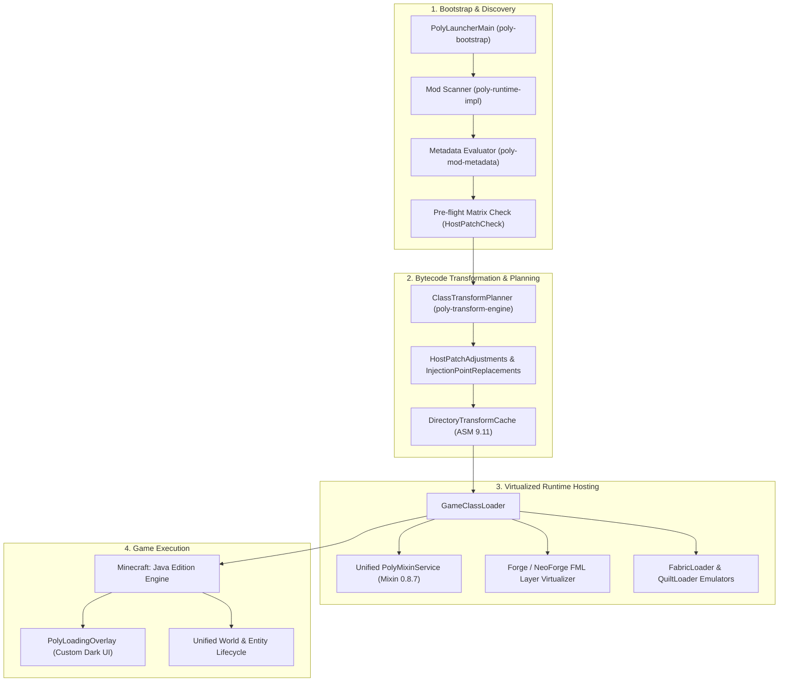

# Poly Mod Loader — Architectural Deep Dive

This document details the internal architecture, classloader topology, and bytecode virtualization mechanisms powering Poly Mod Loader.

---

## 1. High-Level Architecture Overview

Poly Mod Loader bridges Minecraft and disparate mod loaders (Fabric, Forge, NeoForge, Quilt) within a **single Java Virtual Machine (JVM)** process.

---

## 2. The Four-Phase Execution Lifecycle

### Phase 1: Discovery & Assessment
1. **Scanning:** `PolyLauncherMain` passes the mods folder and development mod jars to `ModFileScanner`; `NestedJarExtractor` takes out nested jars.
2. **Metadata Evaluation:**
   - Reads `poly.mod.json`, `fabric.mod.json`, `quilt.mod.json`, and `META-INF/mods.toml` / `neoforge.mods.toml`.
   - Normalizes dependencies, versions, and conflict declarations.
3. **Pre-flight Host Patch Check (`HostPatchCheck`):**
   - When Forge or NeoForge is active, the game jar is binary-patched (`ForgePatchSet` or `NeoForgePatchBundle`).
   - Poly inspects all Fabric/Quilt Mixins against the actual patched bytecode.
   - If a mixin cannot safely bind to the host-altered method, it is flagged with `PLEXUS-COMPAT-224` and cleanly excluded before classloading begins.

### Phase 2: Bytecode Transformation Planning
1. **Rule Registration:**
   - Native API mods submit declarative transform rules (`poly-transform-api`).
   - Host loader bridges submit `InjectionPointReplacement` rules (e.g., [`NeoForgeInjectionPoints.java`](poly-bridge-forge/src/main/java/dev/plexusmodloader/compat/forge/NeoForgeInjectionPoints.java)).
2. **Compile-time vs Load-time Planning:**
   - `ClassTransformPlanner` verifies bytecode signatures, instructions, and target selectors.
   - Transformed classes are stored in `DirectoryTransformCache` under a SHA-256 key of the engine, the original class bytes and the rules (default `.poly/transform-cache`, 256 MiB, least recently used entries removed first), so later launches skip the transformation.

### Phase 3: ClassLoader Topology & Unified Mixin
Traditional mod loaders attempt to own the system or thread context classloader (e.g., Forge's ModLauncher or Fabric's Knot). Poly resolves this conflict:
- **`GameClassLoader`:** One transforming class loader serves the entire game. It defines the game's and the mods' classes itself (child-first), so every class goes through the transformer; Poly Mod Loader's own packages, the Java platform and the libraries (LWJGL, log4j, gson, ...) come from the parent. NeoForge's FML gets `PolyTransformingClassLoader` in place of its own, which takes every class from the game class loader.
- **Unified Mixin Engine:** Instead of letting Forge and Fabric spin up competing Mixin instances, Poly initializes a single **`PolyMixinService`** (SpongePowered Mixin 0.8.7 + MixinExtras 0.5.5) that processes Mixin configurations from Fabric, Quilt, Forge and NeoForge mods.
- **FML Module Layering:** Forge's BOOT, SERVICE, and PLUGIN layers are mapped directly into the transforming classloader. `cpw.mods.modlauncher` APIs are satisfied by Poly's virtualized shims without pulling in conflicting classloader hierarchies.

### Phase 4: Runtime Cross-Loader Interoperability
1. **Cross-Loader Mod Listing:**
   - When a Fabric mod queries `FabricLoader.getInstance().isModLoaded("forge_mod")`, Poly's `FabricLoaderRuntime` answers truthfully: it lists the mods of every loader in the launch.
   - When Forge queries `ModList.get().isLoaded("fabric_mod")`, Poly hooks `ModList` to return a synthesized `IModInfo` descriptor (`ForeignModList`).
2. **Registry Synchronization & Dynamic Unfreezing:**
   - NeoForge freezes registries early during boot. Poly's `NeoForgeRegistryOpening` temporarily unfreezes the root registry when Fabric mod entrypoints execute, preventing `IllegalStateException: Registry is already frozen`.
3. **Network Payload Multiplexing:**
   - Both loaders register custom network channels (Fabric `c:register` / `fabric:` vs NeoForge `neoforge:`). Poly's `ForeignPayloads` and bundle packet filters prevent unhandled payload disconnects (`Unknown addon`).

---

## 3. Custom Loading Screen Integration (`PolyLoadingOverlay`)

In Minecraft 26.1, 26.2, and 26.3, third-party loaders (such as Forge's early progress window) interfere with title rendering.
- Poly suppresses third-party splash screens and disables early graphics windows.
- During resource reloading and mod initialization, Poly renders its own **`PolyLoadingOverlay`**:
  - Dark background (`#0E131F`) with animated progress indicator.
  - Live mod count overlay displaying loaded mod counts broken down by loader: `Fabric`, `Forge`, `NeoForge`, `Quilt`, and `Poly`.
  - Color-coded rendering using Minecraft's native `Component.literal` and `ChatFormatting` to guarantee zero font corruption across different GPU drivers.
