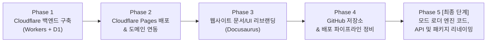

# Poly ➔ Plexus (`plexusmc`) 리브랜딩 및 Cloudflare 인프라 마이그레이션 계획서

- **문서 번호:** PML-PLAN-2026-10-30
- **작성일:** 2026-10-30
- **프로젝트:** Poly Mod Loader ➔ **Plexus Mod Loader (PlexusMC)**
- **대상 인프라:** Google Firebase (Hosting, Functions, Firestore) ➔ **Cloudflare (Pages, Workers, D1, DNS)**
- **핵심 원칙:** **엔진 및 API 코드 수정(Java/Kotlin/Gradle/API/바이너리)은 리스크 최소화를 위해 전체 계획의 맨 마지막(최종 단계)에 일괄 수행**하고, 선행하여 **인프라 이전 ➔ 웹사이트 리브랜딩 ➔ 도메인 전환**을 완료합니다.

---

## 1. 마이그레이션 추진 배경 및 목표

```
[ 현재 문제점 ]
 1. PolyMC(유명 서드파티 런처)와의 심각한 이름 충돌로 커뮤니티/검색(SEO)/GitHub 혼선 발생
 2. 런처가 아닌 "인게임 JVM 바이트코드 통합 로더"로서의 독자적 브랜드 정체성 필요
 3. Firebase Functions의 콜드 스타트 및 Firestore 종량제 비용/접근성 제약

        ▼ 리브랜딩 및 인프라 현대화 추진

[ 전환 목표 ]
 1. 브랜드: 'Plexus(플렉서스 - 망상 조직/신경총)'로 일원화하여 멀티로더 통합 정체성 확립
 2. 인프라: Cloudflare 글로벌 엣지(Pages + Workers + D1)로 이전하여 무제한 대역폭과 0ms 응답성 확보
 3. 무중단 호환성: 기존 모드 생태계와 배포된 버전들이 깨지지 않도록 코드 수정은 최종 단계로 격리
```

---

## 2. 전체 마이그레이션 단계 요약 (로드맵)

엔진 컴파일 및 런타임 호환성에 영향을 주지 않도록 위험도가 낮은 외부 인프라부터 단계적으로 전환합니다.



---

## 3. 세부 단계별 실행 계획

### Phase 1. Cloudflare 인프라 및 백엔드 서비스 구축 (코드 무수정)
> **원칙:** 모드 로더 코드 및 메인 사이트 코드에 일절 손대지 않고, Cloudflare 측에 동일한 기능의 백엔드를 구축하고 데이터 정합성을 검증합니다.

1. **Cloudflare 계정 및 D1 데이터베이스 생성**
   - Cloudflare 대시보드(또는 `wrangler`)를 통해 서버리스 분산 SQL인 **Cloudflare D1** (`plexus-db`) 생성.
   - Firestore 컬렉션을 대체할 SQLite 테이블 스키마 정의:
     - `downloads` (tag, file, downloads, last_at)
     - `download_days` (day, tag, file, downloads)
     - `page_views` (path, views, last_at)
     - `page_view_days` (day, path, views)
     - `bug_reports` (id, created_at, status, kind, loader, mc_version, summary, description, contact, ...)
2. **Cloudflare Workers API 구현 (`site/cloudflare-worker/`)**
   - 현재 `site/functions/index.js`의 기능을 표준 Fetch API 및 D1 바인딩 기반 Worker로 재작성:
     - `GET /`: `Accept-Language` 헤더 기반 언어 감지 ➔ `/ko/` 또는 `/en/`으로 302 리다이렉트
     - `GET /counter/dl.php`: 유효성 검사, D1 다운로드 카운트 증가, GitHub Releases 다운로드 URL로 302 리다이렉트
     - `GET /counter/stats.php`: D1 집계 기반 JSON 통계 반환
     - `POST /counter/view`: D1 페이지뷰 통계 기록
     - `POST /report/submit.php`: Rate-limit 검증 및 버그 제보 D1 삽입
     - `GET/POST /report/admin.php`: Secret 토큰 인증 및 제보 조회/관리
3. **비밀 환경 변수 설정**
   - `wrangler secret put REPORT_TOKEN`
   - `wrangler secret put REPORT_HMAC_KEY`
4. **로컬 및 스테이징 검증**
   - `wrangler dev`를 통해 다운로드 리다이렉트 및 제보 제출/조회 기능 100% 동작 검증.

---

### Phase 2. Cloudflare Pages 정적 호스팅 배포 및 도메인 전환
> **원칙:** 기존 사이트 소스를 Cloudflare Pages에 빌드/배포하여 정적 자산과 Workers 라우트를 연동합니다.

1. **Cloudflare Pages 프로젝트 생성**
   - 프로젝트명: `plexus-site` (또는 `plexusmc`)
   - Pages 빌드 설정:
     - Framework: Docusaurus v3
     - Build command: `npm run build:site`
     - Build output directory: `firebase-public` (또는 지정 outDir)
2. **도메인 연결 및 DNS 세팅**
   - 새 도메인(`plexusmc.net` 등)의 네임서버를 Cloudflare로 지정 (Proxied CNAME / A 레코드).
   - Pages 커스텀 도메인으로 `plexusmc.net` 및 `www.plexusmc.net` 연결.
3. **Workers 라우트 (Custom Domain Routes) 바인딩**
   - `plexusmc.net/counter/*` ➔ 백엔드 Worker 연결
   - `plexusmc.net/report/*.php` ➔ 백엔드 Worker 연결
   - `plexusmc.net/` (루트) ➔ 루트 언어 리다이렉터 Worker 연결
4. **기존 도메인(`polymc.net`) 301 영구 리다이렉트 설정**
   - Cloudflare Page Rules / Redirect Rules 설정:
     - `https://www.polymc.net/*` ➔ `https://www.plexusmc.net/$1` (301 Permanent Redirect)
     - 검색엔진(Google, Naver 등)의 기존 인덱싱 점수 및 외부 백링크 완전 보존.
5. **검색엔진 & 광고 세팅 갱신**
   - Google Search Console 및 Naver Search Advisor에 `plexusmc.net` 새 속성 추가.
   - 루트 `ads.txt` 확인 및 Google AdSense에 새 사이트 추가 신청.

---

### Phase 3. 웹사이트 브랜드 UI 및 문서 리브랜딩 (Docusaurus)
> **원칙:** 웹사이트 상의 표기 텍스트와 디자인 자산만 Plexus로 교체하며, 엔진 코드는 손대지 않습니다.

1. **브랜드 자산(로고/파비콘) 교체**
   - `site/static/img/logo.svg`
   - `site/static/img/favicon.svg`, `favicon-48x48.png`, `apple-touch-icon.png`, `favicon.ico`
   - `site/static/img/social-card.png` (OG 공유 이미지)
2. **사이트 기본 설정 갱신 ([`site/docusaurus.config.js`](file:///C:/Users/HOYA/dev/Poly-Mod-Loader/site/docusaurus.config.js))**
   - `title: 'Plexus'`
   - `tagline`: 'Run Forge, Fabric, NeoForge and Quilt mods together...'
   - `url: 'https://www.plexusmc.net'`
   - 네비게이션 로고 텍스트, 푸터 카피라이트 텍스트 갱신
3. **웹 페이지 텍스트 일괄 개편**
   - 메인 홈페이지 ([`site/src/pages/index.js`](file:///C:/Users/HOYA/dev/Poly-Mod-Loader/site/src/pages/index.js)): "Poly" ➔ "Plexus"
   - 다운로드 페이지 ([`site/src/pages/download.js`](file:///C:/Users/HOYA/dev/Poly-Mod-Loader/site/src/pages/download.js))
   - 개발자 페이지 ([`site/src/pages/developers.js`](file:///C:/Users/HOYA/dev/Poly-Mod-Loader/site/src/pages/developers.js))
   - 버그 리포트 페이지 ([`site/src/pages/report.js`](file:///C:/Users/HOYA/dev/Poly-Mod-Loader/site/src/pages/report.js))
4. **문서(Docs) 및 다국어 번역 일괄 갱신**
   - `site/docs/` (영어) 및 `site/i18n/ko/` (한국어)
   - "Poly Mod Loader" ➔ "Plexus Mod Loader"
   - "Poly 모드 로더" ➔ "Plexus 모드 로더"
   - "Poly" ➔ "Plexus"

---

### Phase 4. GitHub 저장소 및 CI/CD 릴리스 파이프라인 정비
> **원칙:** 저장소 이름 및 배포 액션을 정비하되, Java 소스 코드는 아직 건드리지 않습니다.

1. **GitHub 저장소 리네이밍**
   - `xyrz47-spec/Poly-Mod-Loader` ➔ `xyrz47-spec/Plexus-Mod-Loader`
   - (GitHub 자체 기능으로 이전 URL 접근 시 새 URL로 자동 리다이렉트됨)
2. **GitHub Actions 워크플로우 갱신**
   - `.github/workflows/` 내 저장소 이름 참조 및 릴리스 제목/태그 템플릿 정비
   - Cloudflare Pages 자동 배포 액션(`cloudflare/pages-action`) 구성

---

### Phase 5. [최종 단계] 모드 로더 엔진 코드베이스 & API 리네이밍 (손대는 작업)
> **원칙:** 앞선 모든 인프라와 사이트 이전이 안정화된 후, 가장 마지막에 엔진 코드, 모듈명, API, 파일럿 메타데이터 수정을 체계적으로 단행합니다.

1. **모드 메타데이터 하위 호환성 (가장 중요)**
   - 새 모드 사양: `plexus.mod.json`
   - 기존 모드 호환 보장: 메타데이터 로더에서 `plexus.mod.json`을 1순위로 찾고, 없으면 기존 `poly.mod.json`을 읽도록 fallback 로직 구현.
2. **Gradle 모듈 및 프로젝트 명칭 갱신**
   - `settings.gradle.kts`: `rootProject.name = "plexus"`
   - 모듈명: `poly-core` ➔ `plexus-core`, `poly-bootstrap` ➔ `plexus-bootstrap`, `poly-game-v...` ➔ `plexus-game-v...` 등 점진적 개명 또는 내부 유지 검토.
3. **네임스페이스 및 패키지 이전**
   - 패키지명: `dev.polymodloader.*` ➔ `dev.plexusmodloader.*`
   - 공개 Native API 인터페이스: 기존 패키지 임포트를 사용하는 모드 개발자를 위해 `@Deprecated` 타입 별칭(Type Alias) 또는 브릿지 클래스 제공.
4. **인게임 UI & 런타임 식별자 갱신**
   - 로딩 화면 오버레이: `PlexusLoadingOverlay.java` (브랜드 텍스트 및 큐브 애니메이션 Plexus 스타일 반영)
   - 타이틀 화면 모드 카운터 텍스트: "Plexus mods: X"
   - 내부 에러 코드: `PLEXUS-COMPAT-...` ➔ `PLEXUS-COMPAT-...`
5. **빌드 아티팩트 변경**
   - 설치 프로그램: `PlexusModLoader-<version>.jar`
6. **풀 테스트 스위트 검증**
   - `./gradlew check`
   - `./gradlew serverBootSmokeTest worldCreateSaveTest`
   - `-PpolyMinecraft=26.1, 26.2, 26.3` 전 버전 게임 테스트 및 4대 로더(Fabric, Forge, NeoForge, Quilt) 호환성 코퍼스 전체 통과 검증.

---

## 4. 리스크 관리 및 롤백 대책

| 리스크 요인 | 대응 방안 및 대책 |
| :--- | :--- |
| **기존 모드 작동 중단** | Phase 5에서 `poly.mod.json` 메타데이터 fallback 지원을 기본 탑재하여 기존 빌드된 모드 100% 수용 |
| **기존 사이트 검색엔진 순위 하락** | `polymc.net` ➔ `plexusmc.net` 전 경로 301 영구 리다이렉트 적용으로 백링크/SEO 자산 계승 |
| **다운로드 링크 깨짐** | Cloudflare Worker의 `/counter/dl.php`에서 과거 태그 및 `PolyModLoader-*.jar` 파일명도 정규식으로 매칭하여 GitHub Releases로 정확히 토스 |
| **엔진 리팩토링 중 회귀 버그** | 엔진 코드 수정을 맨 마지막(Phase 5)으로 미루었으므로, 앞 단계 인프라 배포에 컴파일 오류가 전혀 전파되지 않음 |

---

## 5. 작업 실행 체크리스트

- [ ] **Phase 1: Cloudflare 백엔드 구축**
  - [x] Cloudflare D1 데이터베이스 생성 및 스키마 적용 (`plexus-db`, APAC, 2026-10-30)
  - [x] Cloudflare Worker (`site/cloudflare-worker/`) 작성 및 배포 (`plexus-site`, Worker + Static Assets)
  - [x] Secret 토큰 등록 및 엔드포인트 테스트 (로컬 `npm test` 5/5, workers.dev 실측)
  - [x] Firestore 기존 데이터 → D1 이전 (2026-10-30, 다운로드 57·페이지뷰 857·유입 483·제보 1 일치)
- [ ] **Phase 2: Cloudflare Pages & 도메인 전환** (Pages 대신 Worker + Static Assets)
  - [x] 사이트 Worker에 빌드 연동 (`npm run deploy:site`, `deploy.local.json`의 `"cloudflare": {}`)
  - [x] 새 도메인(`plexusmc.net`) DNS 연결 (`www` = 사이트, apex = `plexus-redirect` Worker로 301)
  - [x] 기존 도메인(`polymc.net`) 301 리다이렉트 (현재 Firebase Hosting 리다이렉트, 경로·쿼리 유지)
  - [ ] `polymc.net` 네임서버를 Cloudflare로 이전 후 `plexus-redirect`에 연결, Firebase 정리
  - [x] SDK Maven 저장소 R2(`plexus-maven`) 이전 (2026-10-30, 11,031개, 정적 파일 12,717개 → 1,686개)
  - [ ] Google Search Console·Naver 서치어드바이저 새 속성, AdSense 사이트 추가 (네이버 메타 태그 배포됨, 확인 대기)
- [x] **Phase 3: Docusaurus 웹 리브랜딩**
  - [x] 로고/파비콘 신규 디자인 적용
  - [x] `docusaurus.config.js` 및 페이지 텍스트 변경
  - [x] `docs/` 및 `i18n/ko/` 문서 텍스트 갱신
  - [ ] 새 도메인 `ads.txt` 및 애드센스 신청 (사이트 배포 완료, 애드센스 검토 대기)
- [x] **Phase 4: GitHub 인프라 정비**
  - [x] 저장소 이름 변경 (`xyrz47-spec/Plexus-Mod-Loader`, GitHub 원격 URL 갱신 완료)
  - [x] 배포 워크플로우 갱신 (`docs.yml`, `release.yml`, `publish-release.py` 저장소 경로 갱신)
  - [x] 프로젝트 문서 및 가이드 링크 전역 갱신 (`README.md`, `PROJECT.md`, `DEVELOPING.md`, `RELEASE_AND_DEPLOY.md`)
- [ ] **Phase 5: [최종 단계] 엔진 코드 리팩터링**
  - [x] `plexus.mod.json` + `poly.mod.json` 동시 지원 및 템플릿/에러 코드(`PLEXUS-`) 전환 완료
  - [x] 루트 Gradle 26개 모듈 디렉터리 `plexus-*` 전환 완료
  - [x] 패키지 리네이밍 (`dev.polymodloader.*` ➔ `dev.plexusmodloader.*`, 구 패키지를 참조하는 기존 모드는 클래스 로드 시 자동 리매핑; Maven group·플러그인 ID `dev.polymodloader.mod`는 유지)
  - [ ] 로딩 화면 및 UI 갱신 (`PlexusLoadingOverlay` 등)
  - [ ] 전체 멀티버전 검증 테스트 통과 확인
